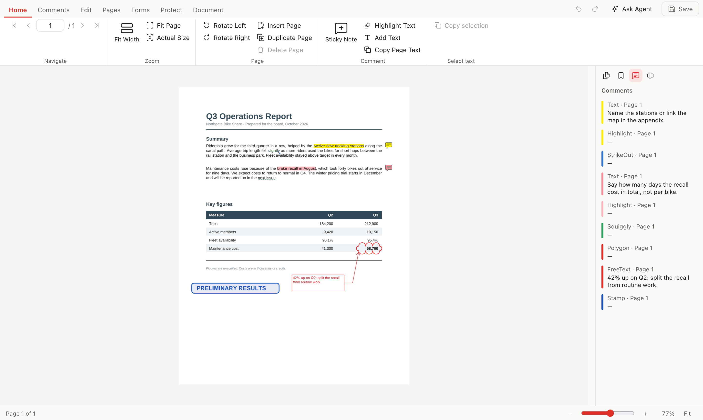
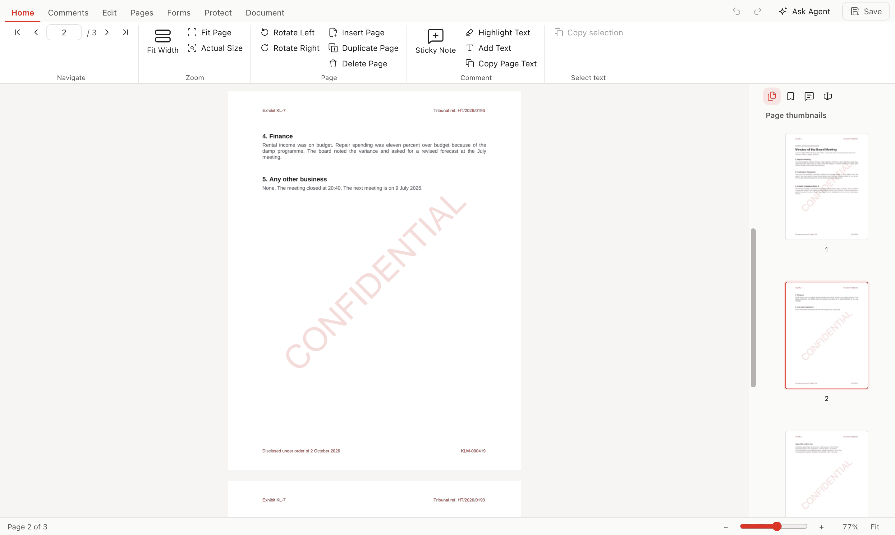
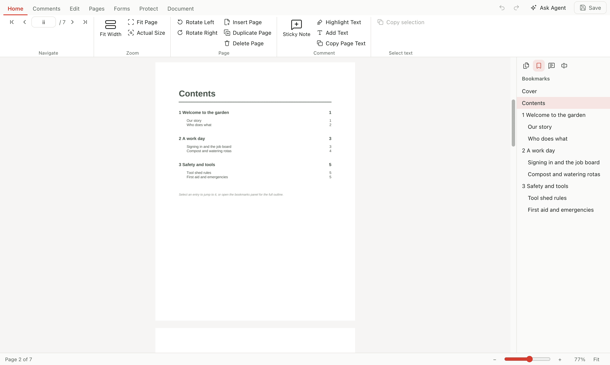
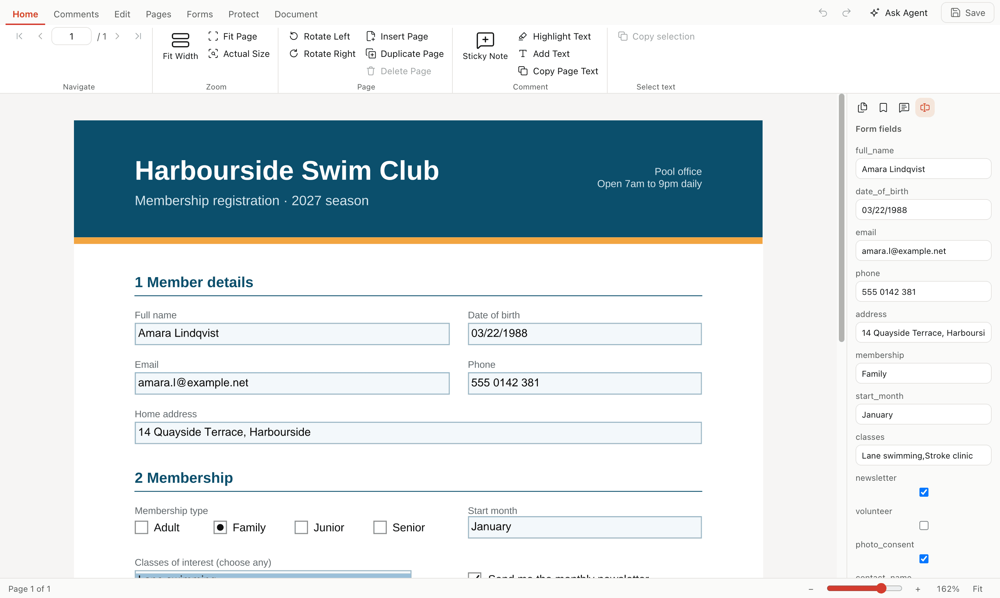
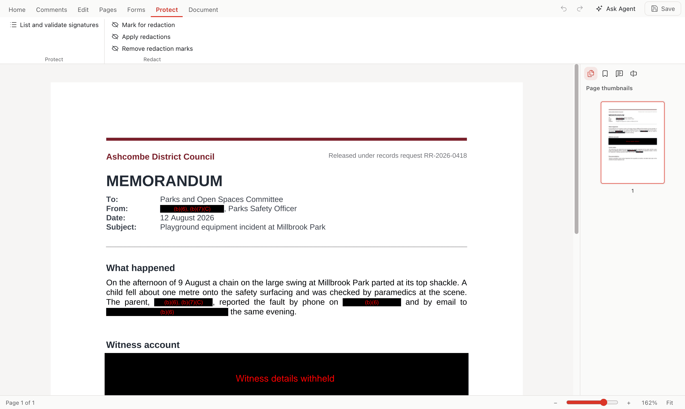
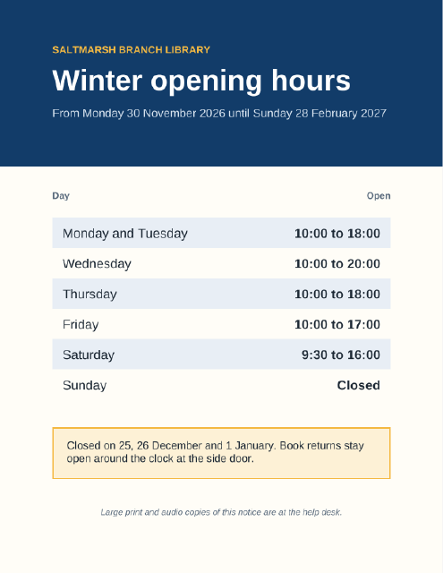
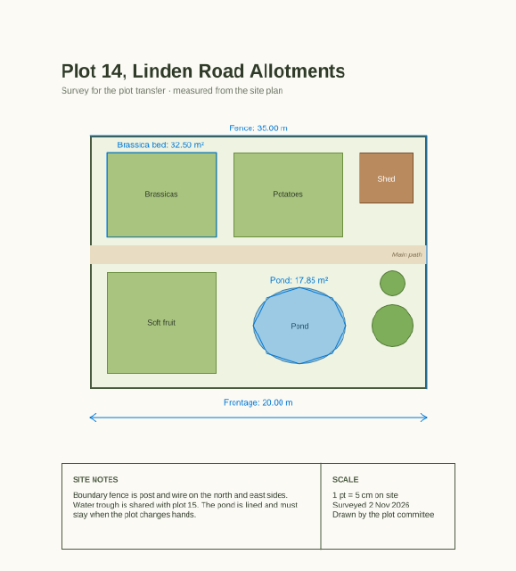

<div align="center">

# Kition PDF

**Kition PDF: read and edit PDF files, for people and AI agents**

Pages · Comments and replies · Forms · Bookmarks and links · Redaction · Agent tools with checks

[](LICENSE)
[](https://www.npmjs.com/package/@kition/embed)
[](https://github.com/kitharness/khp)
[](bindings/wasm)

[Use it in Kition](https://kition.ai) · [Embed it](#embed-it-in-your-app) · [Give it to your agent](#give-it-to-your-agent) · [Showcase](https://github.com/KitionAI/kition-showcase/tree/main/pdf) · [Developer docs](https://developer.kition.ai) · [KHP](https://github.com/kitharness/khp)

</div>

A PDF is where documents end up: the signed contract, the form to fill in, the report with
everyone's comments. Many tools only show it. Others change it in ways you cannot see, and a
black box drawn over a name still leaves the name in the file. An AI agent has it worse: it gets
the text out, but cannot answer a comment or fill a field.

Kition PDF reads and edits the PDF itself. You work with page thumbnails, a ribbon and a side
panel of bookmarks, comments and form fields. An AI agent works on the same file through tools
that run the same engine and the same commands. It lists the comments, replies to them, fills in
the form, and asks the kit's check what is wrong.



## What it does

### Why PDF

- **Changes that last.** Pages you insert, duplicate, rotate or move, crop boxes and page labels,
  bookmarks, links, form values, comments and the text you add all have tests that save the file,
  open it again and find them there.
- **Review together.** Add sticky notes and highlights, reply in threads, and set a review status.
  The side panel lists every comment on every page.
- **Forms that get filled.** Type into text fields, tick check boxes and pick from drop-down lists.
  The side panel shows every field with its value.
- **Redaction that removes.** Applied redactions take the text out of the page and out of the
  saved file, not only out of sight.
- **An agent works on the same PDF.** It reads the pages, lists the comments and the fields, makes
  its change, and fixes what the check reports, such as an empty required field or a dead link.
  Its edits can go to a draft that you review and merge.
- **Open source, in Rust.** Apache-2.0, engine and editor. The engine is compiled to WebAssembly
  and runs in a Web Worker, off your page's main thread.

### See it

<table>
<tr>
<td width="50%"><br /><b>Pages</b>: insert, duplicate, rotate and move pages, and find your way with thumbnails.</td>
<td width="50%"><br /><b>Bookmarks</b>: nested bookmarks take you to their page; add your own, and they stay in the file.</td>
</tr>
<tr>
<td width="50%"><br /><b>Forms</b>: fill in text fields, check boxes and drop-down lists, and see every field's value in one list.</td>
<td width="50%"><br /><b>Redaction</b>: mark what must go, apply it, and the text is gone from the saved file.</td>
</tr>
</table>

### Made with PDF

<table>
<tr>
<td width="25%"><a href="https://github.com/KitionAI/kition-showcase/tree/main/pdf/course-completion-certificate"></a></td>
<td width="25%"><a href="https://github.com/KitionAI/kition-showcase/tree/main/pdf/library-winter-hours-notice"></a></td>
<td width="25%"><a href="https://github.com/KitionAI/kition-showcase/tree/main/pdf/symposium-programme-links"></a></td>
<td width="25%"><a href="https://github.com/KitionAI/kition-showcase/tree/main/pdf/allotment-plot-measurements"></a></td>
</tr>
</table>

Every sample is built with PDF's own commands. [See all of them](https://github.com/KitionAI/kition-showcase/tree/main/pdf).

### Formats

| Opens | Creates | Exports |
| --- | --- | --- |
| `.pdf` (edits and saves it) | `.pdf` | — |

## Quick start

### Use it in Kition

In Kition, a `.pdf` file opens in this editor. Kition's agent edits the same file with the kit's
`pdf_*` tools. [Download Kition](https://github.com/KitionAI/kition/releases/latest).

### Embed it in your app

PDF's editor is a static package you host yourself, mounted into your page with
[`@kition/embed`](https://www.npmjs.com/package/@kition/embed). You keep the files and the users;
the editor reads and writes through the functions you give it.

1. Download `kition-pdf-<version>.tgz` from the
   [latest release](https://github.com/KitionAI/kition-pdf/releases/latest) and serve its
   `pdf-ui/` folder as static files on its own origin, with the headers in the
   [embed reference](https://github.com/KitionAI/kition-sdk/blob/main/docs/platform/reference/embed.md).
2. Install the SDK and mount the editor:

```sh
npm install @kition/embed
```

```ts
import { KitionEmbed } from '@kition/embed'

const editor = await KitionEmbed.mount(document.getElementById('pdf')!, {
  kit: { id: 'kit.pdf', url: 'https://kits.example.com/pdf-ui/' }, // the package you host
  file: { id: 'q3-report', name: 'Q3 report.pdf' },
  storage: {
    read: async (id) => api.read(id),                    // { bytes, version }
    write: async (id, bytes, { expectedVersion }) =>     // refuse a stale version
      api.write(id, bytes, expectedVersion),             // { version }
  },
})
```

Every save carries the version it read, so an edit made elsewhere is never written over. Identity
and permissions, co-editing, and an agent's draft reviewed in your page are in the
[embed guide](https://github.com/KitionAI/kition-sdk/blob/main/docs/sdk/embed.md).

### Give it to your agent

The engine also runs headless as the `kition-pdf` program, and the SDK's `kition-kits-mcp` turns
it into MCP tools (`pdf_inspect`, `pdf_run`, `pdf_check`, …) on a folder of PDFs, for any MCP
client:

```sh
cargo build --release -p kition-pdf
cargo install --git https://github.com/KitionAI/kition-sdk kition-kits --bin kition-kits-mcp
kition-kits-mcp --workspace <folder of PDFs> --kit target/release/kition-pdf
```

A real session on a copy of the showcase's reviewed quarterly report, abridged:

```text
> pdf_inspect {"path":"report.pdf","preview":false}
Opened `report.pdf`: 692 × 872
{…,"details":{"editable":true,"formFields":0,"name":"report.pdf","pages":[{…,"index":0,"label":"1"}],…},"revision":"wja0",…}

> pdf_run {"path":"report.pdf","basis":"wja0","steps":[{"command":"comment_list","params":{"page":1}}]}
Ran 1 commands on `report.pdf` (saved): 692 × 872 Changes: no object changed.
{…"comments":[…,{"author":"Tomas Bekele","contents":"Say how many days the recall cost in total, not per bike.",
  "id":"3173ca78-99bf-4a3b-8384-ef4acf67217a","page":1,"replies":[],"status":null,"type":"Text",…}, …],"count":9…}

> pdf_run {"path":"report.pdf","basis":"wja0","steps":[
    {"command":"comment_reply","params":{"id":"3173ca78-99bf-4a3b-8384-ef4acf67217a","author":"Assistant",
      "text":"Forty bikes for nine days: 360 bike-days in total."}},
    {"command":"comment_set_status","params":{"id":"3173ca78-99bf-4a3b-8384-ef4acf67217a","author":"Assistant","status":"accepted"}}]}
Ran 2 commands on `report.pdf` (saved): 692 × 872 Changes: objects 2 created, 2 changed.

> pdf_run {"path":"report.pdf","steps":[{"command":"comment_list","params":{"page":1}}]}
{…{"author":"Tomas Bekele","contents":"Say how many days the recall cost in total, not per bike.",…,
  "replies":[{"author":"Assistant","contents":"Forty bikes for nine days: 360 bike-days in total.",…}],"status":"Accepted",…}…}

> pdf_check {"path":"report.pdf"}
Checked `report.pdf`: the kit found nothing wrong.
{"diagnostics":[]}
```

The agent answered a reviewer's note in its thread and marked it accepted; both are saved in the
PDF, where any reader that shows comments sees them. The agent's guide is
[agent/guide.md](agent/guide.md).

## Maturity

Version 0.1.0 · KHP 1.0, conformance level `basic`.

| Works today | Partly there | Not yet |
| --- | --- | --- |
| Pages: insert, duplicate, rotate, move, crop and label<br />Comments: notes, highlights, replies and status<br />Filling text fields, check boxes and drop-down lists<br />Bookmarks, links, and text you add to a page<br />Applying redactions; finding text; agent tools with drafts | Editing text the kit did not write<br />Building forms, and form scripts<br />Watermarks, headers and footers<br />Measuring, comparing two files, PDF/A<br />Recognising text in scans (unaccented Latin only) | Printing on Windows and in the browser<br />Encrypted files that open in every reader<br />Exporting to other formats<br />Tagging tools for accessibility |

Known gaps: [docs/gaps.md](docs/gaps.md). What's next: [docs/roadmap.md](docs/roadmap.md).

## Build and contribute

Build and test instructions are in [docs/development.md](docs/development.md). Read
[CONTRIBUTING.md](.github/CONTRIBUTING.md) before opening a pull request, and ask questions in
[Discussions](https://github.com/KitionAI/kition/discussions) or on [Discord](https://discord.gg/bFSjRDjVY).

## License

Apache-2.0 ([LICENSE](LICENSE)). Third-party licenses and notices are listed in [NOTICE](NOTICE)
and [docs/attribution.md](docs/attribution.md).

Portions of this kit are derived from a project licensed under the MIT License, used here under
that license and credited in [NOTICE](NOTICE).
